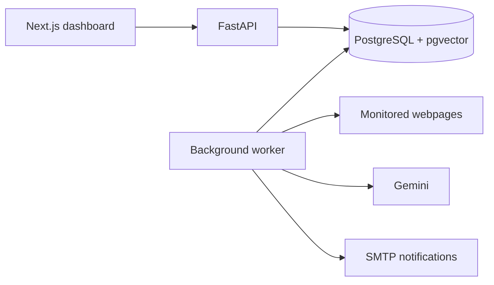

# Sentinel

**A personal webpage-monitoring and decision-support system.**

Sentinel watches selected webpages, records meaningful changes, uses language models to help interpret them, and presents findings and follow-up actions in a private, account-specific workspace.

The project combines a Next.js dashboard, a FastAPI backend, a durable worker process, PostgreSQL/pgvector, and Gemini-powered semantic analysis.

> **Status:** Implementation repository. Feature descriptions below reflect the documented code architecture; they are not a promise of a hosted service or independently verified production uptime.

## What it does

| Capability | Implementation area |
| --- | --- |
| Track webpages | Source registration, check schedules, snapshots, diffing and retries |
| Summarize changes | Semantic relevance, evidence-backed investigations and recommendations |
| Keep workspaces separate | Account-specific sources, findings, actions and profile data |
| Follow up on changes | Suggested actions, progress tracking, alerts and weekly digests |
| Present results | Dashboard with sources, findings, actions and notifications |

## Architecture



The API accepts authenticated user requests; a separate worker performs monitoring and analysis jobs. Database migrations are managed by Alembic, and the frontend uses an API proxy rather than directly exposing backend service addresses to the browser.

## Project layout

```text
app/                  FastAPI API, services, database models and worker
frontend/             Next.js dashboard
alembic/              Database schema migrations
tests/                Python tests for auth, isolation, notifications and orchestration
docker-compose.yml    Local multi-service environment
.env.example          Configuration template
```

## Getting started

**Requirements:** Docker and Docker Compose, access to the configured model provider, and any notification infrastructure you choose to enable.

```bash
cp .env.example .env
# Configure .env for your environment; do not commit credentials.
docker compose up --build
```

The Compose stack defines Postgres, a migration service, an API, a frontend and a background worker. Typical development endpoints defined in the Compose file are `localhost:3000` (dashboard) and `localhost:8000` (API).

For all configuration, authentication and operational details, read the **[complete technical guide](docs/technical-reference.md)** (the project's original long-form README, preserved by the accompanying apply script).

## Tests and verification

The repository contains tests for API authorization, account isolation, alerts, orchestration, recommendation and digest behavior.

```bash
python -m pip install -r requirements.txt
python -m pytest tests
```

This command is the intended test entry point; pass/fail was **not verified** during this documentation-only refresh. Some tests or integration workflows may require configured dependencies.

## Security and deployment notes

Sentinel handles account-specific monitoring records. Use real access controls, secret management, service isolation, appropriate rate limits, and a security review before internet-facing deployment. Never substitute the example Compose database password for a production secret. Do not expose the database port publicly.

See the [technical guide](docs/technical-reference.md) for documented limitations and operational assumptions. No deployment or performance claim is made by this README.

---

**Maintainer:** [Alihassan0155](https://github.com/Alihassan0155) · [Portfolio](https://ali-hassan-khan-portfolio.vercel.app/)
